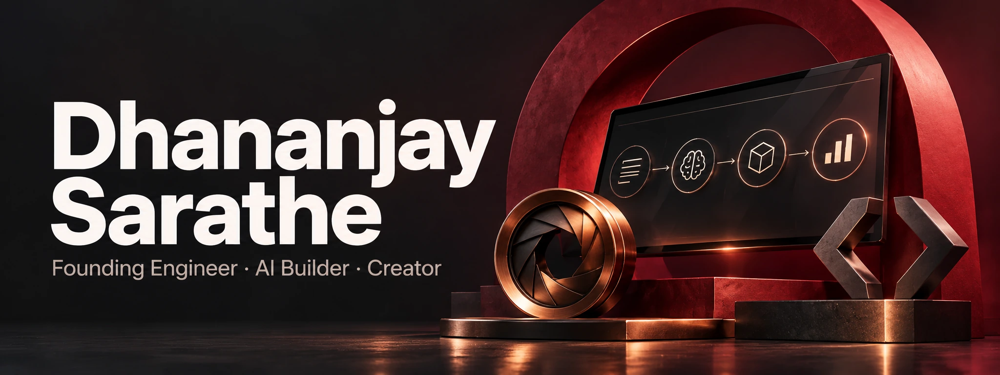

<picture>
  <source media="(max-width: 600px)" srcset="./assets/hero-studio-v3-mobile.webp">
  
</picture>

[LinkedIn](https://www.linkedin.com/in/dhananjay-sarathe-835434149/) &nbsp;·&nbsp;
[ChilledBeer on YouTube](https://www.youtube.com/@ChilledBeer) &nbsp;·&nbsp;
[Instagram](https://www.instagram.com/chilledbeer1211/) &nbsp;·&nbsp;
[Email](mailto:dhananjaysarathe26@gmail.com)

I'm a full-stack engineer in Bengaluru, building AI products from idea to production.
I care about one thing: **shipping things that actually work.**

### Building at Quickads

I joined [Quickads](https://quickads.ai) as a founding intern in 2023 and now work as a **Founding SDE**.
My work spans:

- **AI-powered ad research** — turning ad data into useful product features.
- **Real-time scraping engines** — the systems behind the research.
- **Autonomous competitor intelligence agents** — bringing research and automation together.

### Projects outside work

| Project | What I'm building |
| :--- | :--- |
| **StockTax Pro** | A tax-loss harvesting tool for Indian traders, built to solve a problem I ran into myself. |
| **[prunify](https://github.com/DhananjaySarathe/prunify)** | A CLI for finding dead code, duplicate logic, unused dependencies, and circular imports. |
| **[ChilledBeer Video Edits](https://github.com/DhananjaySarathe/chilledbeer-video-edits)** | A local Claude Code workflow for video editing, captions, motion graphics, and quality checks. |

### ChilledBeer — what I'm learning, on camera

On [ChilledBeer](https://www.youtube.com/@ChilledBeer), I share practical AI workflows for coding, video creation, and everyday work: the setups, results, costs, and things that go wrong.

**[My Claude Video Editing Setup Is Now Yours (GitHub Repo)](https://www.youtube.com/watch?v=WUhBkOJsEIc)**  
The workflow behind my open-source video editing setup.

[More on the channel →](https://www.youtube.com/@ChilledBeer)

### Stack

| Area | Tools |
| :--- | :--- |
| **Product** | TypeScript · JavaScript · React · Next.js · Tailwind |
| **Backend** | Node.js · Express · Python |
| **Data** | PostgreSQL · MongoDB · Redis |
| **Infrastructure** | Docker · AWS · Git |
| **AI** | Agents · Embeddings · Prompt engineering |

<strong>How I got here</strong>

- **2021** — Started BTech and learned to think through DSA problems.
- **2022** — Went all-in on full-stack development. Built, broke, and learned.
- **2023** — Joined Quickads as a founding intern.
- **2024** — Shipped AI to production and started ChilledBeer.
- **2025** — Graduated and became a Founding SDE.
- **2026** — Building AI workflows, creator tools, and the next useful thing.

---

Always happy to talk about **products, practical AI, and building things**.
[Say hello →](mailto:dhananjaysarathe26@gmail.com)
